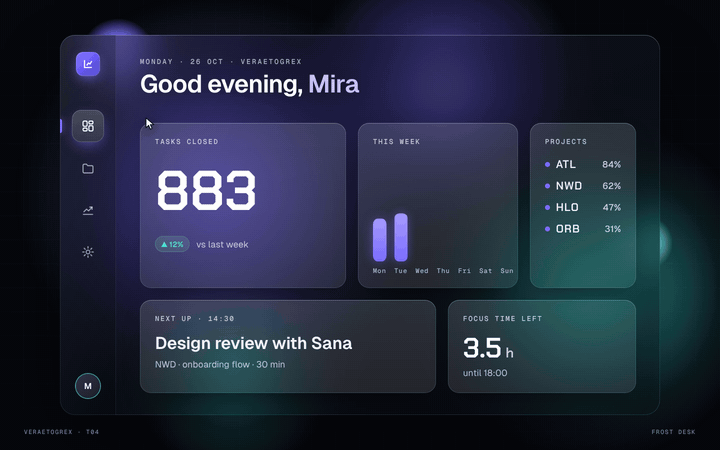

# Frost Desk

**Frosted glass dashboard — every page blurs into the next.**



**Live demo:** [veraetogrex-portfolio.github.io/frost-desk](https://veraetogrex-portfolio.github.io/frost-desk/) · **Mockup:** [full-screen version](https://veraetogrex-portfolio.github.io/frost-desk/mockup/frost-desk.html)

Every page change dissolves the content layer into the frosted glass, swaps it, and brings it back into focus while its counters run and its charts draw. Text sits on denser glass so it stays readable on a phone screen.

## Use it

Three files, no build step, no dependencies, no web fonts:

```
index.html   markup
style.css    styles and keyframes
script.js    behaviour
```

Download the repo and open `index.html`, or copy the three files into your project.

## Try it

- Click the sidebar icons.
- Keys `1`–`4` switch pages.

## Make it yours

Page content is plain HTML in `index.html`. Counter targets (1 284 tasks, 312 hours) are in `script.js`. Colours are CSS custom properties at the top of `style.css`.

`prefers-reduced-motion` is respected: heavy motion drops to short fades.

## What's in `mockup/`

The full 1440×900 screen this component was shot in for the reel:

- `mockup/frost-desk.html` — interactive. `D` plays the demo, `R` resets.
- `mockup/frost-desk.autoplay.html` — the scripted ~6 s loop with a drawn cursor.
- URL flags: `?frame` puts the screen in a browser window, `?clean` hides the control panel, `?once` plays the demo once.

The mockup uses a shared stage runtime and bundled fonts from `mockup/_shared/`. The component in the root doesn't need any of it.

---

Component 04 of a series. New one every day on Instagram [@veraetogrex_portfolio](https://www.instagram.com/veraetogrex_portfolio/) · all components: [github.com/veraetogrex-portfolio](https://github.com/veraetogrex-portfolio)

MIT licensed.
